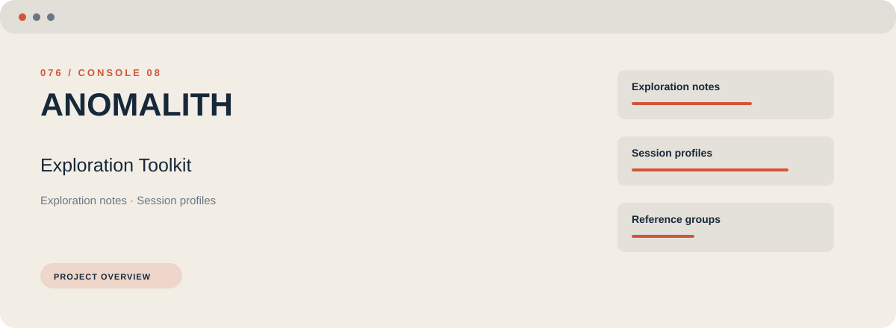
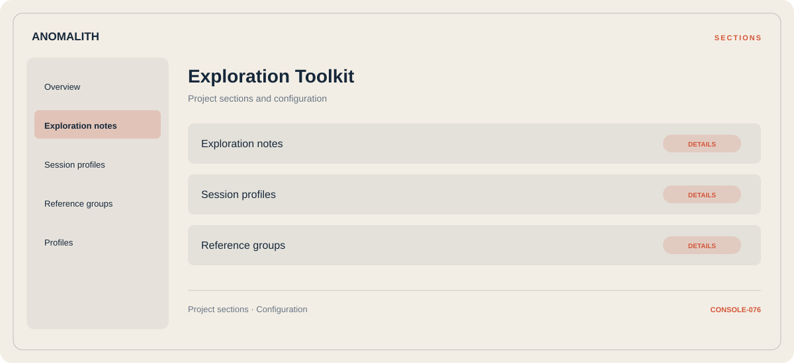

# 🛠️ ANOMALITH Exploration Toolkit

**Exploration notes · Session profiles · Reference groups**

## ⚡ Features

Start with exploration notes, organize session profiles, and keep reference groups close at hand. These are the main areas covered by ANOMALITH Exploration Toolkit.

### ⚙️ Exploration notes

A dedicated section for exploration notes and the configuration details associated with that area.

### 🧩 Session profiles

Related settings collected into named groups for a clearer configuration workflow.

### ⌨️ Reference groups

A dedicated section for reference groups and the configuration details associated with that area.

## 🖥️ Project navigation

## 📥 Download

The button and cover open the project's download page. Use the information supplied with the downloaded package for installation and release-specific requirements.

## 📚 Project documentation

- [Feature reference](docs/FEATURES.md)
- [Download information](docs/DOWNLOAD.md)
- [Project page](index.html)

---

ANOMALITH Exploration Toolkit · Program documentation and download information.
